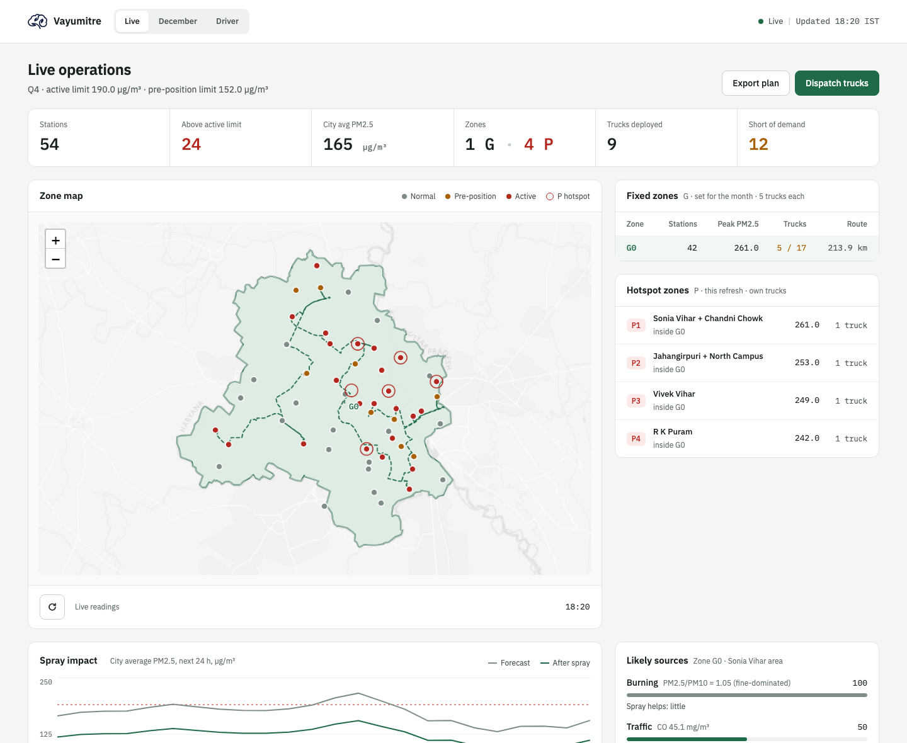
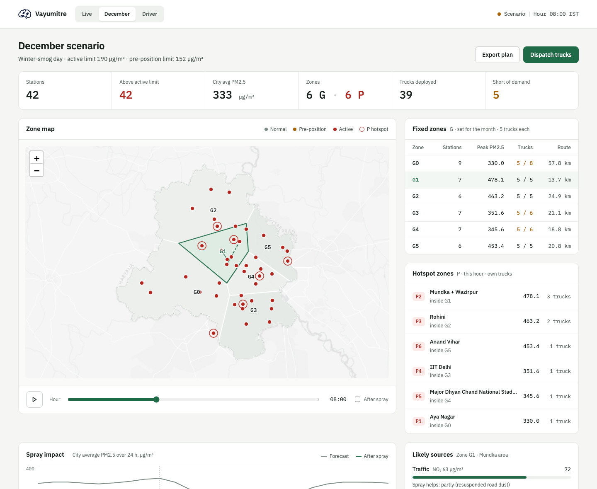
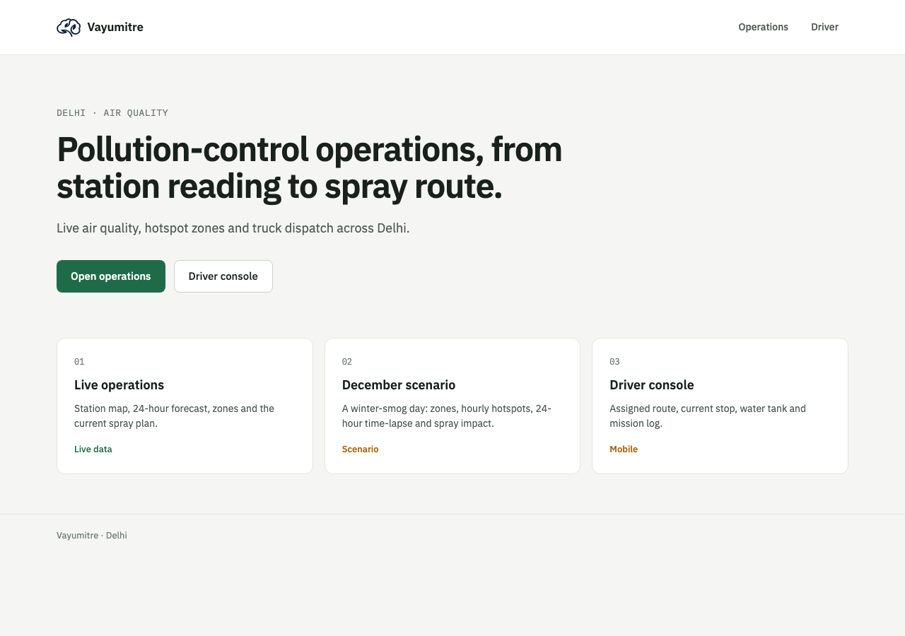
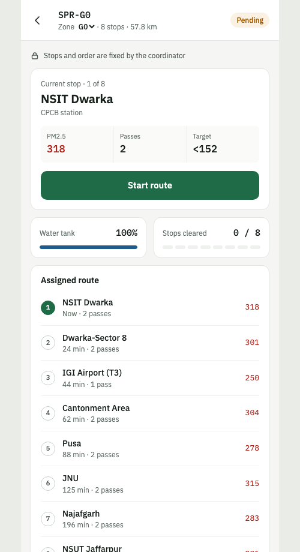

# Vayumitre v1

Pollution-control operations for Delhi, built on the CPCB air-quality station network.
Live station readings are forecast 24 hours ahead, grouped into drivable zones, diagnosed
for their likely source, and turned into truck spray dispatch with a console for every driver.

**Live demo:** https://krishiv47.github.io/vayumitre-delhi/ (Home, December scenario and Driver console; the Live page needs the Python server — see Run).

## Screenshots

**Live operations** — live station map, fixed G zones, hourly P hotspots, trucks and likely sources



**December scenario** — a winter-smog day with a 24-hour time-lapse and dispatch run



| Home | Driver console |
| --- | --- |
|  |  |

## How it works

1. **Read** — current pollutants for 42 Delhi monitors from CPCB (data.gov.in), with
   Open-Meteo CAMS as an automatic fallback.
2. **Forecast** — XGBoost models predict PM2.5 at 1, 3, 6, 12 and 24 hours for every monitor,
   anchored to that monitor's own reading.
3. **Zone** — G zones are formed once a month from the spray workload; P hotspot zones are
   re-found every hour.
4. **Diagnose** — a rule-based fingerprint of the pollutant mix ranks the likely source
   (dust, burning, traffic, industry, …) and whether spraying helps.
5. **Dispatch** — a fixed crew per G zone plus standalone trucks for each hotspot, routed on
   real roads, with a closed loop: spray, re-read the air, re-plan.

## Layout

```
index.html  admin.html  december.html  driver.html   pages (no build step)
ops.js  ops.css                                       shared operations dashboard
assets/                                               logo and icon
server.py                                             static server + /api/forecasts, /api/zones, /api/plan
engine/   net.py air.py forecast.py forecast_live.py  data clients, XGBoost forecasting
          zoning.py causes.py                         zone rules, likely-cause attribution
          models/                                     trained 1/3/6/12/24 h PM2.5 models
tools/    fetch_live_clusters.py build_regions.py     generators (write into data/)
          build_routes.py truck_sizing.py build_december.py
          monthly_zones.py monthly_maps.py
data/     *.json                                      zones, territories, plans, December scenario
```

## Run

```bash
pip install -r requirements.txt
python3 server.py            # http://localhost:8124/
```

Pages: `/` home · `/admin.html` live operations · `/december.html` December scenario ·
`/driver.html` driver console (`?src=live` for the live plan).

## Regenerate

```bash
python3 tools/fetch_live_clusters.py   # zones from current readings
python3 tools/build_regions.py         # zone territories
python3 tools/build_december.py        # synthetic December scenario (--geo-k to force a zone count)
python3 tools/monthly_maps.py          # Vayumitre_monthly_zone_maps.pdf (reference)
```

## Zone rules (`engine/zoning.py`)

- **Workload** — each station needs the spray passes that bring it below the pre-position limit
  (one pass cuts PM2.5 by about 42.5%). Total workload sets the number of G zones (about 12 passes
  per zone, 1–8), so dirtier air gives more zones and clean air fewer. Zones are compact and carry
  equal workload.
- **G zones** — fixed for the whole month, formed from each station's typical recent level and saved
  to `data/zones_live.json`. Each has a fixed crew (`TRUCKS_PER_ZONE`, default 5).
- **P hotspot zones** — inside a G zone, a station at or above the active limit that also stands out
  from its own zone (mean + 1σ) becomes a standalone P zone of at most 2 stations. Its trucks are
  sized to its own workload and exist only while the hotspot does.

## Likely cause (`engine/causes.py`)

Ranks dust, burning, traffic, industry, photochemical haze, ammonia sources and regional haze from
PM2.5/PM10, NO₂, SO₂, CO, O₃ and NH₃ plus the time of day. It reports the likely dominant source,
not proof. The December scenario uses a synthetic pollutant mix.

## Data sources

CPCB via data.gov.in (primary), Open-Meteo CAMS (fallback and forecast history),
OSRM (road routes), OpenStreetMap (Delhi boundary).
